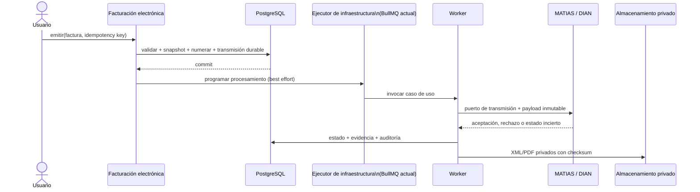

# PR10 — Arquitectura de Facturación Electrónica

| Campo               | Valor                                                                                                 |
| ------------------- | ----------------------------------------------------------------------------------------------------- |
| **Estado**          | Aceptada con ajustes de revisión técnica                                                              |
| **Fecha**           | 2026-07-29                                                                                            |
| **Ámbito**          | SaaS multiempresa «La Oficina Nítida» · facturación electrónica DIAN                                  |
| **Implementación**  | Ninguna en este PR; PR11 inicia el dominio tras la aprobación                                         |
| **Decisores**       | Equipo de arquitectura y producto                                                                     |
| **ADR consolidado** | [ADR-005 — Arquitectura de facturación electrónica](adr/ADR-005-electronic-invoicing-architecture.md) |

## Resumen ejecutivo

La facturación electrónica será un **bounded context de dominio dentro del monolito**. La plataforma será la fuente de verdad de la intención comercial, del ciclo de vida, de la numeración asignada, de los snapshots y de la evidencia operativa. MATIAS será el proveedor externo de transmisión, validación DIAN y entrega de artefactos autorizados; no dictará el modelo de dominio interno.

La emisión es asíncrona y durable. Una factura solo queda `ACEPTADA` cuando se ha recibido y persistido evidencia de aceptación del proveedor/DIAN. Los reintentos son _at-least-once_ a nivel del ejecutor de infraestructura, pero el resultado de negocio es idempotente: una factura no se transmite ni se contabiliza dos veces.

BullMQ es el ejecutor previsto hoy, no una dependencia del dominio. El dominio y los casos de uso dependen únicamente de un **puerto de transmisión electrónica**; BullMQ u otro mecanismo solo despierta el procesamiento de transmisiones persistidas y puede sustituirse sin cambiar las reglas de negocio.

Este documento no modifica Prisma, NestJS, endpoints, adaptadores ni configuraciones. Al aprobarse, es la especificación arquitectónica de referencia para los PR11 en adelante.

## 1. Objetivos del módulo

1. Emitir facturas de venta electrónicas válidas para cada empresa facturadora y conservar su evidencia verificable.
2. Evitar números duplicados, reemisiones accidentales y doble transmisión ante reintentos, concurrencia o caídas de red.
3. Mantener un historial inmutable de lo que se emitió: emisor, adquirente, ítems, impuestos, totales, payload, respuesta y archivos autorizados.
4. Aislar la integración con MATIAS mediante un puerto; un cambio de proveedor no debe alterar las reglas ni los estados del dominio.
5. Respetar el aislamiento multiempresa: una empresa no puede usar la resolución, credenciales, consecutivos, clientes, artefactos ni auditoría de otra.
6. Producir un hecho fuente apto para contabilización: conforme a ADR-001, solo una factura `ACEPTADA` podrá disparar la causación de venta de forma idempotente.
7. Dar operación recuperable: toda emisión incierta se reconcilia antes de crear o retransmitir un documento.

## 2. Alcance del MVP

### Incluido

- Factura electrónica de venta nacional en COP, para un adquirente y una empresa emisora por documento.
- Borrador, validación, reserva de numeración, transmisión, consulta/reconciliación y evidencia de aceptación o rechazo.
- Ítems, descuentos e impuestos soportados por el contrato vigente de MATIAS y la configuración fiscal del tenant.
- Almacenamiento privado y descarga autorizada de XML y PDF resultantes, con checksum y origen trazables.
- Numeración por resolución/rango, idempotencia de comando y de transmisión, reintentos técnicos y auditoría.
- Sandbox antes de producción, observabilidad operativa y reconciliación programada de estados inciertos.
- Integración contable posterior a la aceptación, como PR separado y dependiente del núcleo de ADR-001.

### Fuera del MVP

- Notas crédito y débito, factura de exportación, AIU, contingencia, POS, documento soporte, RADIAN, nómina electrónica y multimoneda funcional.
- Recaudo, cartera, pagos, facturación recurrente, inventario, portal del adquirente y entrega de correo propia.
- Cálculo fiscal configurable mediante reglas libres; se implementarán únicamente reglas expresamente soportadas y aprobadas.
- Integración directa con DIAN, firma propia o almacenamiento/gestión local de certificados si MATIAS los administra.
- Migración automática de facturas históricas internas al esquema electrónico; se decidirá y ejecutará en un PR de transición específico.

## 3. Límites del dominio

| Contexto                    | Responsabilidad                                                                                         | No es responsable de                                                             |
| --------------------------- | ------------------------------------------------------------------------------------------------------- | -------------------------------------------------------------------------------- |
| **Facturación electrónica** | Documento fiscal, snapshots, estados, numeración, transmisión, evidencia y reconciliación.              | Inventario, cobro, contabilidad, certificados propios o UI de clientes.          |
| **Clientes / productos**    | Catálogos comerciales editables por tenant.                                                             | Alterar una factura ya numerada; la factura conserva su snapshot.                |
| **MATIAS / DIAN**           | Autenticación del proveedor, validación/transmisión, identificadores externos y artefactos autorizados. | Modelo de dominio, autorización interna, tenant isolation o decisión de negocio. |
| **Contabilidad**            | Causar la venta aceptada mediante su puerto y su propia idempotencia.                                   | Cambiar el estado fiscal de la factura.                                          |
| **Auditoría**               | Evidencia transversal de actor, cambio y motivo.                                                        | Sustituir el historial de transmisión ni guardar secretos.                       |

El módulo actual de `billing` es facturación interna y no equivale, por sí solo, a un documento fiscal electrónico. Durante la transición coexistirá con el nuevo agregado; no se extenderá a ciegas ni se le otorgará validez DIAN. El PR de transición definirá una única fuente de verdad para las rutas operativas y la migración, si aplica.

## 4. Modelo de entidades

Los nombres son de dominio, no una instrucción de modelo Prisma. Todas las entidades persistentes llevan `id`, `tenantId`, `createdAt` y, cuando sea apropiado, `updatedAt`; los UUID son internos y los instantes se almacenan en UTC.

| Entidad                        | Rol y campos conceptuales                                                                                                                                    | Invariantes principales                                                                                |
| ------------------------------ | ------------------------------------------------------------------------------------------------------------------------------------------------------------ | ------------------------------------------------------------------------------------------------------ |
| **FacturaElectronica**         | Agregado raíz: tipo, estado, emisor/adquirente snapshot, moneda, fecha de emisión, totales, prefijo/número, CUFE, versión y referencias externas.            | Un tenant, una moneda COP en MVP; al numerarse queda inmutable; única por `(tenant, prefijo, número)`. |
| **LineaFacturaElectronica**    | Snapshot de producto/servicio, descripción, unidad, cantidad, precio, descuentos, impuestos y totales de línea.                                              | Pertenece a una sola factura; los totales se calculan y validan desde las líneas.                      |
| **PerfilEmisorElectronico**    | Configuración fiscal por tenant: identidad, responsabilidades, dirección/municipio, contacto, ambiente, referencia de credenciales y estado de habilitación. | Un perfil activo por tenant y ambiente; nunca contiene secretos en claro.                              |
| **RangoNumeracionElectronica** | Resolución/autorización, prefijo, desde/hasta, siguiente número, vigencia, tipo documental y estado.                                                         | Activo y vigente para emitir; la asignación es atómica; un número asignado no se reutiliza.            |
| **TransmisionElectronica**     | Comando durable hacia el proveedor: factura, payload canónico/hash, intento, estado técnico, bloqueo, respuesta, error y próxima ejecución.                  | Una transmisión activa por factura/payload; los reintentos conservan exactamente el payload y número.  |
| **ReferenciaProveedor**        | Identificadores de MATIAS/DIAN, CUFE y timestamps de aceptación o rechazo.                                                                                   | Un identificador externo pertenece a una sola factura del tenant.                                      |
| **ArtefactoElectronico**       | XML, PDF y, si se recibe, representación gráfica: ubicación privada, checksum, tipo, versión y origen.                                                       | El archivo se asocia a una factura aceptada y su checksum es verificable.                              |
| **RegistroIdempotencia**       | Resultado de una operación mutante: clave, operación, hash de solicitud, resultado y expiración operativa.                                                   | Único por `(tenant, operación, clave)`; misma clave con distinto hash se rechaza.                      |
| **AuditLog** existente         | Actor, acción, antes/después, motivo, correlación y metadatos seguros.                                                                                       | Append-only operativo; sin secretos ni payloads completos con PII innecesaria.                         |

Los datos de cliente, producto, impuesto, dirección y emisor se copian como **snapshot estructurado** al documento antes de numerarlo. Editar los catálogos después no cambia una factura fiscal. El payload canónico se deriva de dicho snapshot, no de lecturas vivas de otros módulos.

## 5. Estados de una factura

```text
BORRADOR ──validar──> LISTA_PARA_EMITIR ──reservar número──> EN_COLA
   │                         │                                  │
   └──descartar──────────────┘                                  v
                                                   EN_TRANSMISION / PENDIENTE_CONCILIACION
                                                                    │
                                                    ┌───────────────┼────────────────┐
                                                    v               v                v
                                                ACEPTADA         RECHAZADA     ERROR_TECNICO
                                                                   (final)       ──reintento──┘
```

| Estado                   | Editable                                  | Número | Regla                                                                                                                                                 |
| ------------------------ | ----------------------------------------- | ------ | ----------------------------------------------------------------------------------------------------------------------------------------------------- |
| `BORRADOR`               | Sí                                        | No     | Documento comercial aún no fiscal. Puede descartarse.                                                                                                 |
| `LISTA_PARA_EMITIR`      | No salvo volver explícitamente a borrador | No     | Validaciones de negocio completas; aún no se ha consumido consecutivo.                                                                                |
| `EN_COLA`                | No                                        | Sí     | Transmisión durable creada y número asignado en la misma transacción.                                                                                 |
| `EN_TRANSMISION`         | No                                        | Sí     | Un worker tiene el intento en curso; el bloqueo expira y se recupera.                                                                                 |
| `PENDIENTE_CONCILIACION` | No                                        | Sí     | Hubo timeout, caída o respuesta ambigua. Primero se consulta al proveedor; nunca se reemite a ciegas.                                                 |
| `ACEPTADA`               | No                                        | Sí     | Existe respuesta de aceptación y se preservan referencias y artefactos disponibles. Estado final para la factura de venta.                            |
| `RECHAZADA`              | No                                        | Sí     | Rechazo funcional/fiscal definitivo del payload. No se reutiliza el número; una corrección crea el documento permitido por la regla fiscal aplicable. |
| `ERROR_TECNICO`          | No                                        | Sí     | Error recuperable sin confirmación de recepción; el mismo payload se reintenta o pasa a conciliación.                                                 |

No existe `ANULADA` para una factura ya aceptada: su corrección se realiza mediante el documento fiscal que corresponda (por ejemplo, una nota crédito), fuera del MVP. Una factura descartada antes de numerarse no deja documento fiscal. La máquina de estados prohíbe transiciones manuales genéricas.

## 6. Flujo completo de emisión

1. Un usuario autorizado crea y edita el `BORRADOR` dentro de su tenant.
2. El dominio valida identidad fiscal, perfil emisor activo, adquirente, líneas, impuestos, totales COP, rango disponible y reglas del tipo documental.
3. Se genera el snapshot y el payload canónico; se calcula su hash. El usuario solicita emitir con una clave de idempotencia.
4. En una sola transacción de base de datos se comprueba la idempotencia, se asigna el siguiente número del rango de forma atómica, se congela el snapshot, se crea `TransmisionElectronica` y la factura pasa a `EN_COLA`. Se escribe auditoría.
5. Tras el commit, un ejecutor de infraestructura programa el procesamiento. BullMQ es la opción inicial y solo acelera la ejecución; la transmisión durable es la fuente de verdad y un reconciliador recoge periódicamente transmisiones pendientes aunque no hayan llegado al ejecutor.
6. El ejecutor invoca el caso de uso de transmisión, que adquiere un bloqueo de corta duración y lleva la factura a `EN_TRANSMISION`. El caso de uso depende solo del puerto de transmisión; el adaptador traduce el payload canónico al contrato MATIAS y llama al proveedor.
7. Se persiste la respuesta normalizada, los identificadores externos y los artefactos disponibles. Si la aceptación es concluyente, la factura pasa a `ACEPTADA`; si el rechazo es fiscal/funcional, a `RECHAZADA`.
8. Ante timeout o respuesta no concluyente, se registra `PENDIENTE_CONCILIACION`. Un proceso consulta por referencia externa, número y/o CUFE según permita MATIAS antes de decidir reintentar.
9. Al aceptar, se guardan XML y PDF en almacenamiento privado, se verifica el checksum y se registra la auditoría. La contabilización es otro consumidor idempotente del evento de negocio `FACTURA_ACEPTADA`, no parte de la llamada a MATIAS.



## 7. Integración con MATIAS API

MATIAS se integra detrás de un **puerto de transmisión electrónica**. El dominio y sus casos de uso solo conocen operaciones normalizadas: transmitir, consultar estado, recuperar artefactos y, si el contrato lo permite, procesar notificaciones. El adaptador MATIAS será infraestructura y contendrá autenticación, URL, DTOs externos, mapeos y códigos propios del proveedor. El ejecutor de trabajos es otro detalle de infraestructura: BullMQ solo invoca los casos de uso sobre transmisiones persistidas y se puede reemplazar sin alterar el puerto ni las reglas del dominio.

**Principio de desacoplamiento:** el payload canónico del dominio nunca será el DTO del proveedor. El dominio define su propio modelo y el adaptador es responsable de traducir hacia y desde MATIAS API. Ningún tipo, código de error o convención de MATIAS se filtra al agregado fiscal ni a sus reglas de negocio.

Decisiones de integración:

- Cada tenant es el emisor y titular fiscal. Sus credenciales, habilitación, rangos y ambiente se resuelven desde su `PerfilEmisorElectronico`; no desde el body ni una clave global compartida.
- Las credenciales se guardan como referencia a un secreto gestionado/cifrado, con rotación y auditoría de cambios. Nunca se incluyen en `AuditLog`, errores, logs ni payloads de respuesta al cliente.
- La configuración de URL/ambiente ya reservada en el proyecto se interpreta como infraestructura; no sustituye la configuración por tenant necesaria para operar en modalidad Software Propio.
- Se usan timeout explícito, reintento con backoff exponencial y _jitter_ solo para fallos técnicos transitorios. Un circuit breaker por proveedor+ambiente evita saturar una caída general; las facturas quedan para recuperación, no se pierden.
- Si MATIAS expone una clave idempotente, se enviará la clave estable derivada de `tenantId + facturaId + hashPayload`. Si no la expone, la prevención se basa en la transmisión durable y la conciliación previa a cualquier repetición.
- Webhooks son una optimización, no una dependencia del MVP: deben validarse criptográficamente, deduplicarse por identificador del evento y coexistir con polling de reconciliación.

El sitio de MATIAS declara una API REST, OAuth 2.0, sandbox separado y PDF/XML autorizados; también indica que cada empresa factura como titular habilitado ante DIAN. El PR de _spike_ debe confirmar el contrato versionado real —campos obligatorios, autenticación, idempotencia, consulta, webhooks, códigos de error, recuperación de archivos, límites y semántica de numeración— antes de implementar el adaptador. [MATIAS API](https://matias-api.com/) · [proceso de integración](https://matias-api.com/proceso-integracion/) · [documentación DIAN](https://micrositios.dian.gov.co/sistema-de-facturacion-electronica/documentacion/)

## 8. Estrategia de numeración

La numeración pertenece al tenant y a un `RangoNumeracionElectronica`: tipo documental, prefijo, resolución/autorización, inicio, fin, vigencias y contador. No se captura como texto libre y no se asigna en borrador.

- Se asigna al aceptar el comando de emisión, junto con el snapshot y la transmisión durable, mediante una actualización atómica dentro de una transacción corta.
- La unicidad se protege por `(tenantId, prefijo, numero)`. Un contador, rango o resolución nunca se comparte entre tenants.
- La aplicación bloquea rangos vencidos, inactivos, agotados o sin perfil emisor habilitado. Alertas operativas anticipan vencimiento y agotamiento.
- El número queda consumido e inmutable desde `EN_COLA`, aun si la transmisión termina rechazada o debe conciliarse. Las excepciones, saltos o anulaciones se explican por auditoría; jamás se “rellena” reutilizando un número.
- La configuración inicial de rangos y su cambio requieren rol administrativo, validación de no solapamiento y motivo auditado. No hay edición destructiva de un rango con números ya asignados.

## 9. Idempotencia y concurrencia

La arquitectura asume entrega _at-least-once_ de trabajos y fallos de red; no promete una llamada HTTP exactamente una vez.

| Capa                  | Mecanismo                                                                   | Resultado                                                                                             |
| --------------------- | --------------------------------------------------------------------------- | ----------------------------------------------------------------------------------------------------- |
| Comando de usuario    | `RegistroIdempotencia` con clave, operación y hash de solicitud.            | Repetir la misma solicitud devuelve el mismo resultado; reutilizar la clave con otro contenido falla. |
| Numeración            | Transacción y contador atómico.                                             | Dos emisiones simultáneas no toman el mismo número.                                                   |
| Transmisión           | Una transmisión durable activa por factura+hash y bloqueo recuperable.      | El worker no realiza envíos paralelos de una factura.                                                 |
| Red ambigua           | `PENDIENTE_CONCILIACION` antes de repetir.                                  | Se evita crear doble documento al no saber si MATIAS recibió la solicitud.                            |
| Notificación/consulta | Identificador externo o de evento único.                                    | Webhooks, polling y reintentos no duplican cambios de estado.                                         |
| Contabilidad          | Clave de origen de ADR-001: `(tenant, origenTipo, origenId, origenEvento)`. | Una factura aceptada causa a lo sumo un comprobante de venta.                                         |

Los cambios de estado se hacen con control optimista de versión o equivalente transaccional. Un bloqueo vencido no autoriza una reemisión automática: obliga a consultar la evidencia externa primero.

## 10. Auditoría y evidencia

Se reutiliza `AuditLog` central. Se auditan como mínimo creación, edición, validación, solicitud de emisión, numeración, cada transición, intento y resultado de proveedor, reconciliación, descarga de artefactos, cambio de rango, cambio de perfil emisor y toda operación administrativa con motivo, actor y correlación.

La factura numerada, sus líneas, snapshots y payload canónico son inmutables. La evidencia incluye hash del payload, identificadores de MATIAS/DIAN, CUFE cuando exista, timestamps, código/mensaje normalizado, checksum y ubicación de XML/PDF. Los originales y respuestas completas se conservan en almacenamiento privado con controles de acceso por tenant; el log operativo conserva metadatos redactados, no secretos ni datos personales superfluos.

La retención fiscal, la política de borrado y la recuperación de evidencia se definirán con asesoría legal/tributaria antes de producción; el sistema no debe asumir que un `DELETE` funcional equivale a una corrección fiscal.

## 11. Multiempresa y seguridad de aislamiento

- El `tenantId` se deriva exclusivamente de la sesión/JWT. No se acepta desde body, query, prefijo, número ni callback externo.
- Toda lectura, bloqueo, unicidad, artefacto, rango, perfil, idempotencia y consulta externa se delimita por tenant. Las claves naturales relevantes comienzan por `tenantId`.
- Los workers reciben `invoiceId` y recuperan el tenant desde la factura persistida; no confían en metadatos de cola controlables por el usuario.
- R2 usa claves privadas con prefijo por tenant y autorización de descarga en el servicio. No se almacenan URL públicas permanentes de XML/PDF.
- Los usuarios solo operan facturas de su tenant y dentro de su rol. Los cambios de configuración fiscal/numeración son administrativos y auditados.
- Fechas de negocio se evalúan en la zona configurada de Colombia para emisión y vigencias; instantes técnicos y auditoría se guardan en UTC.
- La operación de soporte entre tenants requiere un mecanismo de impersonación o soporte explícito, con autorización y auditoría; no se resuelve omitiendo filtros.

## 12. Riesgos y mitigaciones

| Riesgo                                              | Impacto                           | Mitigación arquitectónica                                                                                        |
| --------------------------------------------------- | --------------------------------- | ---------------------------------------------------------------------------------------------------------------- |
| Cambio normativo DIAN o contrato MATIAS             | Rechazos o incumplimiento.        | Puerto aislado, payload canónico versionado, sandbox y _spike_ contractual previo al adaptador.                  |
| Timeout después de que MATIAS recibe el envío       | Doble documento.                  | Estado de conciliación obligatorio, consulta antes de reintento e idempotencia del proveedor si está disponible. |
| Rango agotado/vencido o mal configurado             | Imposibilidad de emitir.          | Validación previa, alertas, bloqueo de solapamientos y auditoría de cambios.                                     |
| Credenciales comprometidas o compartidas            | Emisión fraudulenta/cross-tenant. | Secretos por tenant, referencias cifradas, rotación, no logueo y mínimos privilegios.                            |
| Diferencia entre catálogo vivo y documento enviado  | Inconsistencia fiscal.            | Snapshots inmutables y payload derivado solo del agregado.                                                       |
| Caída de MATIAS/DIAN o del ejecutor (BullMQ actual) | Facturas pendientes.              | Transmisión durable, ejecutor reemplazable como acelerador, reconciliador, backoff y circuit breaker.            |
| Datos personales en logs o artefactos públicos      | Riesgo de privacidad.             | Redacción, almacenamiento privado, control por tenant y auditoría de descargas.                                  |
| Convivencia con módulo interno actual               | Doble fuente de verdad.           | PR de transición con ownership, equivalencias y fecha de corte explícitos.                                       |
| Discrepancia factura–contabilidad                   | Estados financieros incorrectos.  | Posteo solo desde `ACEPTADA`, evento de origen estable y conciliación con ADR-001.                               |
| Operación sin soporte humano                        | Documentos atrapados.             | Bandeja de pendientes, razones normalizadas, reintento seguro y guía de resolución.                              |

## 13. Decisiones de arquitectura

| ID    | Decisión                                                                                                                                                           | Alternativas descartadas                                                                         | Consecuencia                                                                       |
| ----- | ------------------------------------------------------------------------------------------------------------------------------------------------------------------ | ------------------------------------------------------------------------------------------------ | ---------------------------------------------------------------------------------- |
| FE-01 | Contexto de facturación electrónica dentro del monolito modular.                                                                                                   | Microservicio independiente; extender sin límite el billing interno.                             | Menor complejidad operacional y límites claros; se requiere disciplina de módulos. |
| FE-02 | `FacturaElectronica` es agregado fiscal con snapshot inmutable desde la numeración.                                                                                | Leer catálogos vivos; permitir edición tras envío.                                               | Evidencia reproducible; las correcciones crean nuevos documentos.                  |
| FE-03 | Numeración local por rango/tenant, asignada atómicamente al emitir.                                                                                                | Campo manual; asignarla en borrador; delegarla implícitamente al proveedor.                      | El dominio controla trazabilidad; debe sincronizarse contractualmente con MATIAS.  |
| FE-04 | Transmisión durable y casos de uso dependientes solo del puerto de transmisión; BullMQ es un ejecutor reemplazable, no fuente de verdad ni dependencia de dominio. | Llamada síncrona en el request; confiar solo en la cola; acoplar las reglas a BullMQ.            | Recuperación ante caídas y mejor UX; añade estados técnicos explícitos.            |
| FE-05 | MATIAS detrás de puerto y capa anticorrupción; el payload canónico del dominio nunca es el DTO del proveedor y el adaptador traduce hacia/desde MATIAS.            | Exponer DTOs/códigos MATIAS en el dominio; adoptar el payload del proveedor como modelo interno. | Cambio de proveedor o contrato localizado; requiere mapeo dedicado.                |
| FE-06 | Cada tenant tiene perfil fiscal y secreto/referencia de proveedor propios.                                                                                         | Una API key global para todos los tenants.                                                       | Alineado con emisor titular y aislamiento; exige onboarding por empresa.           |
| FE-07 | Conciliación obligatoria antes de reintentar una respuesta ambigua.                                                                                                | Repetir automáticamente cualquier timeout.                                                       | Reduce duplicados; puede aumentar el tiempo de resolución.                         |
| FE-08 | Aceptación fiscal dispara contabilidad mediante ADR-001, en PR separado.                                                                                           | Contabilizar al crear/enviar; acoplar MATIAS al ledger.                                          | El libro solo recibe hechos válidos; existe consistencia eventual controlada.      |
| FE-09 | Artefactos autorizados privados con checksum; auditoría central reutilizada.                                                                                       | URL pública; guardar binarios y secretos en logs.                                                | Más trazabilidad y privacidad; se debe gestionar retención/costo.                  |

Las decisiones FE-01 a FE-09 quedan consolidadas en un único ADR aceptado: [ADR-005 — Arquitectura de facturación electrónica](adr/ADR-005-electronic-invoicing-architecture.md). No se crearán ADR independientes por cada decisión.

## 14. Roadmap de implementación en PRs pequeños

| PR                                                       | Objetivo entregable                                                                                                                                            | Dependencias / no incluye                                                                                             |
| -------------------------------------------------------- | -------------------------------------------------------------------------------------------------------------------------------------------------------------- | --------------------------------------------------------------------------------------------------------------------- |
| **PR11 — Dominio fiscal base**                           | Agregado, estados, validadores puros, snapshots, totales e invariantes; modelo persistente y pruebas de transición.                                            | No MATIAS, no worker, no endpoints de emisión pública.                                                                |
| **PR12 — Emisor y numeración**                           | Perfil emisor, rangos/resoluciones, asignación atómica, controles de vigencia/agotamiento y auditoría administrativa.                                          | Depende PR11; no transmite documentos.                                                                                |
| **PR13 — Validación del contrato real MATIAS (sandbox)** | _Spike_ versionado: autenticación, payload, respuestas, consulta, archivos, idempotencia, límites y códigos de error; resultado y decisión de mapeo aprobados. | No adaptador, no producción ni lógica de negocio nueva. Requiere cuenta sandbox y datos de habilitación.              |
| **PR14 — Adaptador MATIAS y transmisión durable**        | Puerto, adaptador MATIAS, transmisión persistente, ejecutor de infraestructura (BullMQ inicial), locks, retries, circuit breaker y métricas.                   | No inicia hasta que el resultado de PR13 esté validado y aprobado; depende PR11–PR13; no UI completa ni contabilidad. |
| **PR15 — Reconciliación y evidencia**                    | Consulta/polling, manejo de incertidumbre, deduplicación de webhook si existe, XML/PDF privados, checksums y bandeja operativa.                                | Depende PR14; no notas.                                                                                               |
| **PR16 — Superficie de producto y permisos**             | Casos de uso, endpoints, autorización, UX de borrador/emisión/estado y descarga controlada.                                                                    | Depende PR11–PR15; no altera facturas aceptadas.                                                                      |
| **PR17 — Endurecimiento operativo**                      | Pruebas E2E sandbox, pruebas de concurrencia/caos, alertas de rango y fallos, runbooks, dashboards y salida controlada a producción.                           | Depende PR16 y habilitación real de cada tenant.                                                                      |
| **PR18 — Integración contable (C4)**                     | Mapper de venta y posteo idempotente al puerto contable cuando la factura sea `ACEPTADA`; conciliación.                                                        | Depende ADR-001 C1 y PR15; no recaudo/cartera.                                                                        |
| **PR19 — Notas crédito/débito**                          | Nuevo agregado/flujo referenciado a factura aceptada, reglas de corrección y transmisión.                                                                      | Fuera del MVP; depende de aprendizaje de producción.                                                                  |

## Criterios de aprobación de PR10

- La revisión acepta los límites del MVP, la máquina de estados y que una factura aceptada no se edita ni se anula manualmente.
- Se valida la responsabilidad por tenant de MATIAS, credenciales, perfil fiscal y rangos de numeración.
- Se acepta que el número se consume al crear la transmisión durable y que los fallos ambiguos se concilian antes de repetir.
- Se confirma que PR13 valida y aprueba el contrato técnico real de MATIAS en sandbox; PR14 no puede iniciar el adaptador hasta que esa validación esté cerrada.
- Se aprueba la secuencia PR11–PR18 como ruta de implementación y la separación con el posteo contable de ADR-001.

---

_Fin de PR10. Las decisiones quedan aceptadas y consolidadas en ADR-005; puede comenzar PR11._
