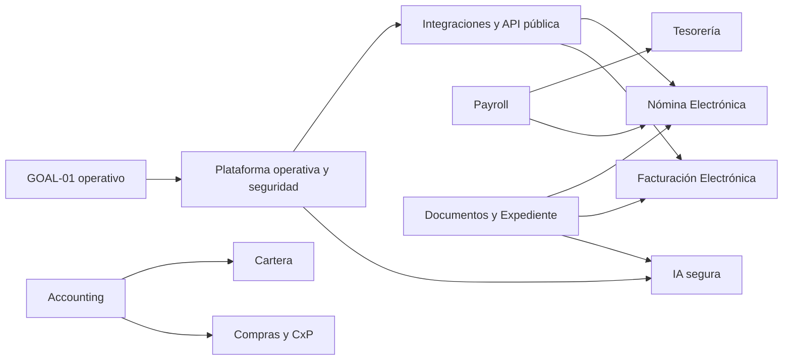

# Platform Evolution — Arquitectura de Evolución de la Plataforma

**Estado:** referencia arquitectónica aprobada
**Alcance:** evolución del producto sin crear un Goal nuevo
**Goal activo:** [GOAL-01 — Primer Cliente Operando](../goals/GOAL-01-primer-cliente-operando.md)
**Fuente de contraste:** `main` en `1c69924d`

## Propósito

Platform Evolution describe cómo puede crecer la plataforma a partir de los
motores que ya existen. No es un Milestone, una Epic, un Goal ni un calendario
de implementación. Su función es conservar decisiones de arquitectura,
dependencias y oportunidades de plataforma para que los próximos Goals se
definan sobre evidencia y no sobre improvisaciones.

La evolución se organiza por dominios y relaciones de dependencia. El orden
indicado en cada iniciativa es una prioridad de desbloqueo, no una secuencia
temporal obligatoria.

## Estado de trabajo durante GOAL-01

La metodología distingue tres dimensiones:

| Dimensión      | Estado actual              | Significado                                                            |
| -------------- | -------------------------- | ---------------------------------------------------------------------- |
| GOAL-01        | `ACTIVO`                   | El resultado de negocio y sus criterios de aceptación siguen vigentes. |
| Implementación | `BLOQUEADA SELECTIVAMENTE` | M1, M2 y M7 tienen dependencias externas o decisiones pendientes.      |
| Arquitectura   | `DISPONIBLE`               | Platform Evolution deja preparada la evolución sin abrir otro Goal.    |

Una implementación bloqueada no impide realizar arquitectura, planificación,
investigación o preparación que acerque el producto al Goal activo.

La auditoría vigente identificó que E7.3 requiere una frontera de plataforma
antes de implementar una captura pública pre-tenant. Esa frontera quedó
aceptada en [ADR-008](../adr/ADR-008-demo-request-capture-boundary.md); E7.3
queda fuera del alcance mínimo de GOAL-01 y no se considera una capacidad
implementada.

## Evidencia actual

El repositorio contiene un monolito modular con NestJS, Next.js, Prisma y
PostgreSQL. El contraste del código en `main` confirma capacidades operativas
en autenticación, tenant context, empleados, contratos, documentos,
expediente, alertas, Payroll y Contabilidad.

También confirma límites que deben respetarse:

- no existe API pública con identidad de integraciones;
- no existe un bus de eventos ni un outbox general;
- no existe un motor genérico de workflows o reglas;
- el correo cubre recuperación de contraseña, no un centro de notificaciones;
- la facturación activa es interna y no transmite a la DIAN;
- no existe transmisión de nómina electrónica;
- el scheduler actual no es una plataforma distribuida de jobs;
- las migraciones activan y fuerzan RLS tenant-scoped en 19 tablas de empleados,
  seguridad social, PILA, prima, recaudos y facturación electrónica; el resto
  del esquema continúa dependiendo de filtros en la aplicación y no se ha
  verificado el estado operativo de una base desplegada;
- staging, producción, R2 y correo real todavía requieren evidencia operativa.

La documentación futura debe seguir tratándose como hipótesis hasta
contrastarla con código, migraciones, pruebas y comportamiento verificable.

## Principios de evolución

1. Mantener un único Goal activo.
2. Mantener el monolito modular mientras no exista evidencia que justifique
   extraer servicios.
3. Reutilizar los motores existentes; no crear autenticación, auditoría,
   documentos, almacenamiento o contabilidad paralelos.
4. Mantener tenant isolation, RBAC y snapshots históricos en cada módulo.
5. Tratar la evidencia documental y contable como append-only cuando el dominio
   lo requiera.
6. Separar el dominio interno de proveedores, reguladores y servicios externos.
7. Introducir complejidad transversal solo cuando exista un segundo caso de uso
   que pruebe que el motor es necesario.

## Motores reutilizables

| Motor                     | Estado en el código                                     | Consumidores previstos                            |
| ------------------------- | ------------------------------------------------------- | ------------------------------------------------- |
| Identidad y autenticación | JWT, refresh rotation y recuperación                    | Usuarios, portales, API e integraciones           |
| Tenant context            | `tenantId` y `ActiveTenantGuard`                        | Todos los dominios                                |
| Autorización              | RBAC `ADMIN`/`OPERADOR`; permisos granulares pendientes | Aprobaciones, finanzas y API                      |
| Empleados y sedes         | CRUD, importación, sedes e identidad                    | Payroll, PILA, portales y cumplimiento            |
| Contratos                 | Perfiles, vínculos, lotes y snapshots                   | Payroll, expediente y regulatorio                 |
| Motor documental          | Plantillas, resolución, generación y estados            | Certificados, desprendibles y documentos fiscales |
| Expediente                | Familias, revisiones, historial y permisos              | Evidencia laboral y regulatoria                   |
| PDF                       | Renderizado con Puppeteer                               | Nómina, facturas, certificados y reportes         |
| Storage                   | `StorageProvider`, local y adaptador R2                 | Evidencia, XML, PDF y adjuntos                    |
| Auditoría                 | Eventos de seguridad y operaciones                      | Cumplimiento y trazabilidad                       |
| Scheduler                 | Runs por tenant, reintentos y retención                 | Alertas, integraciones y automatizaciones         |
| Alertas                   | Generación, resolución y auditoría                      | Cumplimiento y vencimientos                       |
| Payroll                   | Cálculo, snapshots, bloqueos y causación                | Tesorería, PILA y nómina electrónica              |
| Accounting                | Ledger, terceros, centros, reportes y cierres           | Cartera, compras, tesorería y facturación         |

El correo, los eventos, las notificaciones, los workflows y la API pública no
se consideran motores existentes. Son oportunidades de plataforma sujetas a
sus propias dependencias.

## Oportunidades transversales de plataforma

### Plataforma operativa y de seguridad

**Objetivo:** disponer de despliegue, secretos, backups, restauración,
observabilidad, RLS y rate limiting verificables.

**Problema de negocio:** sin estas capacidades, el producto no puede sostener
operaciones productivas ni compromisos regulatorios.

**Reutiliza:** health/readiness, auditoría, StorageProvider, tenant context y
workflows de CI existentes.

**Dependencias y riesgos:** requiere infraestructura externa; operar datos reales
sin separación de entornos aumenta el riesgo de pérdida o exposición.

**Orden y relación:** es una condición transversal de M1 y habilita todas las
ramas regulatorias, la API pública y la IA.

### Eventos, automatización y jobs

**Objetivo:** ofrecer una ejecución común para tareas programadas, reintentos,
idempotencia y efectos posteriores.

**Problema de negocio:** cada módulo podría terminar creando su propio sistema
de reintentos y tareas.

**Reutiliza:** scheduler, auditoría, estados, transacciones y alertas.

**Dependencias y riesgos:** primero debe existir un caso real que justifique
procesamiento asíncrono; no se introduce BullMQ o microservicios por anticipado.

**Orden y relación:** después de la plataforma operativa; servirá a
integraciones, notificaciones y transmisión regulatoria.

### Workflows, aprobaciones y reglas

**Objetivo:** compartir patrones de aprobación, bloqueo y transición sin
absorber reglas específicas de Payroll o Contabilidad.

**Problema de negocio:** Payroll, cierres y documentos tienen estados propios,
pero no existe coordinación transversal.

**Reutiliza:** estados de Payroll, cierres, bloqueos, RBAC y auditoría.

**Dependencias y riesgos:** requiere al menos dos casos de uso comparables; un
DSL genérico prematuro aumentaría complejidad y acoplamiento.

**Orden y relación:** después de identificar la repetición real; puede servir a
compras, pagos, facturación y cumplimiento.

### Comunicaciones y notificaciones

**Objetivo:** centralizar correo, notificaciones internas y preferencias.

**Problema de negocio:** el sistema solo tiene correo de recuperación de
contraseña y no dispone de entrega trazable para invitaciones o alertas.

**Reutiliza:** `EmailService`, alertas, scheduler y auditoría.

**Dependencias y riesgos:** correo real, secretos, retención y prevención de
envíos duplicados.

**Orden y relación:** después de M1; habilita E2.2, portales y comunicaciones
operativas.

### Captura comercial y solicitudes públicas de demo

**Objetivo:** convertir la landing en un canal operativo de adquisición, con
captura, seguimiento y contacto verificables para prospectos que aún no tienen
tenant.

**Problema de negocio:** el formulario actual solo simula el envío en el
navegador. Sin una prioridad comercial explícita, implementar persistencia de
prospectos antes del primer cliente agregaría una superficie operativa que no es
necesaria para el recorrido laboral-documental del Goal.

**Reutiliza:** la landing existente, la capa de validación, los adaptadores de
correo y las capacidades transversales de auditoría, retención y control de
acceso que se habiliten en el plano de plataforma.

**Dependencias y riesgos:** ADR-008 define la separación entre plataforma y
tenants; todavía se necesitarían identidad de plataforma, bandeja operativa,
privacidad, retención, anti-abuso y un canal de comunicación verificable. Un
proveedor de correo o CRM debe quedar detrás de un adaptador y no ser la fuente
de verdad del dominio.

**Orden y relación:** fuera del alcance mínimo de GOAL-01. Se prioriza cuando
exista una necesidad comercial verificable de adquisición desde la landing; no
es prerequisito para incorporar y operar el primer tenant. Se relaciona con
Comunicaciones, Integraciones y API pública, pero no con el cierre operativo del
Goal.

### Integraciones y API pública

**Objetivo:** exponer contratos estables para clientes y conectar proveedores
externos mediante adaptadores.

**Problema de negocio:** el BFF web actual no es una API pública versionada y no
existe identidad machine-to-machine.

**Reutiliza:** controladores, autenticación, tenant context, RBAC y auditoría.

**Dependencias y riesgos:** API keys/OAuth, scopes, cuotas, versionado, rate
limiting y revisión de seguridad.

**Orden y relación:** primero se define la frontera de integración; después se
prioriza un consumidor real, no una API genérica sin caso de uso.

## Iniciativas por dominio

### Operación laboral

#### Payroll y cumplimiento laboral

- **Objetivo:** evolucionar Payroll desde cálculo y causación hacia obligaciones,
  novedades avanzadas y salidas regulatorias.
- **Problema:** los errores de nómina tienen impacto legal, financiero y de
  confianza.
- **Reutiliza:** empleados, contratos, PayrollRun, PayrollSnapshot, bloqueos,
  correcciones, Accounting y auditoría.
- **Dependencias:** validación de Payroll v1, parámetros legales y aceptación
  operativa.
- **Riesgos:** cambios normativos y cálculos de alta sensibilidad.
- **Orden:** rama principal de evolución laboral después del cierre operativo de
  GOAL-01.
- **Relación:** alimenta Tesorería, PILA, Nómina Electrónica, Contabilidad y el
  futuro portal del empleado.

#### Portal de empleado

- **Objetivo:** permitir consulta segura de expediente, documentos y
  certificados.
- **Problema:** reduce carga administrativa y mejora el acceso del empleado.
- **Reutiliza:** Empleado, ExpedienteDoc, documentos generados, StorageProvider y
  autenticación.
- **Dependencias:** correo, invitaciones, permisos granulares y privacidad.
- **Riesgos:** exposición de información laboral y gestión de identidad externa.
- **Orden:** después de identidad, comunicaciones y seguridad productiva.
- **Relación:** consume el expediente existente; no crea un repositorio paralelo.

### Financiero

#### Tesorería y pagos

- **Objetivo:** controlar obligaciones y pagos derivados de Payroll, compras y
  cartera.
- **Problema:** el Ledger reconoce obligaciones, pero no registra su pago,
  dispersión o conciliación.
- **Reutiliza:** Payroll, Tercero, Ledger, comprobantes y auditoría.
- **Dependencias:** Payroll causado, datos bancarios, terceros y formatos de
  pago.
- **Riesgos:** datos bancarios incompletos e integraciones específicas por banco.
- **Orden:** primera expansión financiera después de Payroll.
- **Relación:** consume Payroll y alimenta conciliación y reportes.

#### Cartera

- **Objetivo:** controlar vencimientos, saldos, recaudos y aplicación de pagos.
- **Problema:** la facturación interna no gestiona cuentas por cobrar.
- **Reutiliza:** Customer, Invoice, Tercero, Ledger y auditoría.
- **Dependencias:** facturación estable, pagos y reglas de aplicación.
- **Riesgos:** pagos parciales, notas y conciliación.
- **Orden:** después de estabilizar Billing.
- **Relación:** conecta Facturación, Tesorería y Estados Financieros.

#### Compras y cuentas por pagar

- **Objetivo:** gestionar proveedores, obligaciones y causación.
- **Problema:** existen terceros y contabilidad, pero no existe el proceso de
  compras.
- **Reutiliza:** Tercero, documentos, centros de costo, Ledger, workflows y
  auditoría.
- **Dependencias:** workflows, Accounting y documentos de proveedor.
- **Riesgos:** expansión prematura hacia un ERP genérico.
- **Orden:** después de Cartera o ante una necesidad comercial concreta.
- **Relación:** alimenta Tesorería y Estados Financieros.

#### Reportes financieros avanzados

- **Objetivo:** ampliar los reportes existentes con flujo de efectivo, patrimonio,
  notas y exportaciones.
- **Problema:** Diario, Mayor, Balance y Resultados ya existen, pero no cubren
  todas las necesidades de gestión.
- **Reutiliza:** Ledger, `saldos()`, cierres, terceros y centros de costo.
- **Dependencias:** nuevas fuentes de hechos económicos.
- **Riesgos:** presentar información incompleta como integral.
- **Orden:** después de integrar Cartera, Tesorería y Compras.
- **Relación:** es consumidor de Contabilidad, no un libro paralelo.

### Regulatorio

#### Nómina Electrónica

- **Objetivo:** emitir y transmitir documentos mediante un proveedor especializado.
- **Problema:** el cliente necesita cumplimiento sin mantener directamente toda la
  infraestructura de transmisión.
- **Reutiliza:** PayrollSnapshot, GeneratedDocument, StorageProvider, scheduler,
  idempotencia y auditoría.
- **Dependencias:** Payroll, plataforma operativa, proveedor, certificados y
  ambiente de pruebas.
- **Riesgos:** cambios normativos, rechazos, duplicados y custodia de secretos.
- **Orden:** después de la frontera de integraciones; no depende de Tesorería.
- **Relación:** produce evidencia y estados normalizados para Payroll y el
  expediente.

#### Facturación Electrónica

- **Objetivo:** emitir documentos fiscales mediante un proveedor especializado.
- **Problema:** Billing actualmente crea facturas internas, no documentos
  transmitidos.
- **Reutiliza:** Customer, ProductService, Invoice, Tercero, Ledger, PDF,
  StorageProvider y auditoría.
- **Dependencias:** agregado fiscal, numeración, impuestos, certificados y
  proveedor.
- **Riesgos:** los modelos heredados de FE no equivalen a una integración real;
  extenderlos sin decisión produciría retrabajo.
- **Orden:** después de una decisión específica de dominio e integración.
- **Relación:** alimenta Cartera y Contabilidad.

### Inteligencia

#### IA documental y operativa

- **Objetivo:** asistir en clasificación, extracción, búsqueda y detección de
  inconsistencias.
- **Problema:** el volumen documental y las reglas laborales dificultan la
  operación manual.
- **Reutiliza:** expediente, contratos, plantillas, documentos, alertas y
  auditoría.
- **Dependencias:** clasificación de datos, permisos granulares, identidad de
  agente, confirmación humana y política de proveedores.
- **Riesgos:** filtración de datos, decisiones incorrectas y acciones no
  auditables.
- **Orden:** después de seguridad y con un caso de uso concreto.
- **Relación:** consume los motores documentales; no crea una fuente de verdad
  paralela.

## Frontera regulatoria: dominio y proveedor

La plataforma debe mantener el siguiente límite:

```text
Dominio interno → Puerto regulatorio propio → Adaptador → Proveedor externo
```

El dominio es dueño de empleados, periodos, conceptos, facturas, numeración
interna, estados normalizados, idempotencia, auditoría y evidencias.

El proveedor es dueño de credenciales, DTOs, endpoints, identificadores
externos, códigos técnicos y particularidades de su API.

El dominio no importa tipos de Matías, DIAN ni otro proveedor. El adaptador
traduce solicitudes y respuestas a un contrato interno estable. Cambiar de
proveedor no debe modificar Payroll, Billing, Expediente, Contabilidad ni la UI.

## Grafo de evolución



Este grafo no ordena el calendario. Expone qué capacidades deben existir antes
de que otra iniciativa sea segura y evita que una rama bloqueada detenga todo
el Goal si aún existe trabajo arquitectónico o preparatorio útil.

## Gobernanza

- Platform Evolution no es un Goal y no puede crear GOAL-02 por sí sola.
- Las iniciativas futuras permanecen sin numerar hasta que un único Goal activo
  las priorice.
- Una nueva decisión de arquitectura o dominio requiere su ADR antes de
  implementar.
- Toda iniciativa debe contrastarse con el código real, migraciones, pruebas y
  resultado observable del cliente.
- La documentación no declara una capacidad implementada: la evidencia
  ejecutable sigue siendo la fuente de verdad.
