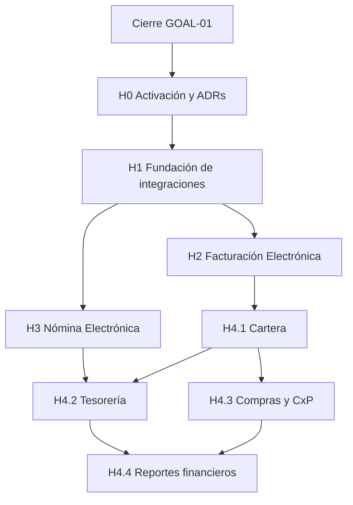

# GOAL-02 — Evolución Financiera y Cumplimiento Electrónico

> **Estado:** documento base de planificación — **NO ES UN GOAL ACTIVO**.
>
> GOAL-01 continúa siendo el único Goal activo. Este documento no autoriza
> implementación, no modifica el resultado de GOAL-01 y no convierte sus
> iniciativas en trabajo priorizado hasta que GOAL-01 se cierre y el producto
> active explícitamente este Goal.

## Propósito

Definir la arquitectura de evolución para que la plataforma pueda operar
facturación electrónica, nómina electrónica y capacidades financieras
relacionadas sin convertir el SaaS en un ERP genérico ni acoplar el dominio a
un transmisor específico.

El nombre describe una evolución de negocio, no una secuencia obligatoria de
calendario. Las iniciativas podrán ejecutarse en paralelo cuando sus
dependencias estén resueltas y exista un caso comercial verificable.

## Resultado de negocio propuesto

Cuando este Goal sea activado, un tenant podrá:

- emitir documentos de facturación electrónica mediante un proveedor
  especializado, observando estados normalizados y conservando la evidencia de
  transmisión;
- generar y transmitir nómina electrónica a partir de una liquidación aprobada
  e inmutable, incluyendo rechazos, reintentos y correcciones trazables;
- administrar las consecuencias financieras de facturación, nómina, compras y
  pagos con el Ledger existente como fuente contable;
- sustituir el proveedor de transmisión sin modificar Payroll, Billing,
  Contabilidad, Expediente ni la interfaz de usuario;
- reconstruir cada resultado regulatorio y contable desde su hecho interno,
  snapshot, intento de integración y evidencia almacenada.

Este resultado no implica construir un motor propio de transmisión a la DIAN o
la UGPP. La hipótesis de planificación es integrar inicialmente un proveedor
especializado, por ejemplo Matías API o un equivalente, detrás de adaptadores
propios.

## Alcance y límites

### Dentro del alcance propuesto

1. **Facturación Electrónica:** evolución de la factura interna hacia un acto
   fiscal con numeración, impuestos, notas, estados de transmisión, evidencia
   y conciliación con Contabilidad y Cartera.
2. **Nómina Electrónica:** documento regulatorio derivado de PayrollSnapshot,
   con identidad de evento, correcciones, transmisión, respuesta del proveedor
   y conservación de evidencia.
3. **Evolución financiera:** conexión controlada entre hechos de negocio y
   Ledger; Cartera; Tesorería y pagos cuando exista una necesidad operativa;
   Compras y cuentas por pagar; y reportes financieros que consuman fuentes
   contables completas.
4. **Plataforma de integraciones:** puertos internos, adaptadores, credenciales
   por tenant, idempotencia, reintentos, auditoría, observabilidad y pruebas de
   contrato para proveedores externos.

### Fuera del alcance inicial

- implementar transmisión directa propia contra DIAN o UGPP;
- convertir la plataforma en ERP contable integral;
- construir conectores bancarios genéricos antes de validar un banco o flujo
  concreto;
- duplicar Payroll, Invoice, Ledger, documentos o almacenamiento para satisfacer
  a un proveedor;
- aceptar como fuente de verdad los estados, consecutivos o totales devueltos
  por el proveedor;
- diseñar un motor genérico de workflows, eventos distribuidos o microservicios
  sin un caso de uso que justifique la complejidad;
- implementar una integración concreta antes de aprobar las decisiones de
  dominio, seguridad y operación correspondientes.

## Evidencia actual contrastada en `main`

La fuente de contraste de este documento es `main` en `1c69924d`.

| Capacidad                  | Evidencia real                                                                                                                                                         | Límite actual                                                                                                                                                                                                             |
| -------------------------- | ---------------------------------------------------------------------------------------------------------------------------------------------------------------------- | ------------------------------------------------------------------------------------------------------------------------------------------------------------------------------------------------------------------------- |
| Multiempresa y seguridad   | `Tenant`, JWT, `ActiveTenantGuard`, RBAC y `TenantPrismaService`                                                                                                       | La integración regulatoria necesitará credenciales y permisos por tenant.                                                                                                                                                 |
| Empleados y contratos      | `Empleado`, contratos, sedes, perfiles y snapshots                                                                                                                     | Son los insumos laborales; no deben ser modificados por el proveedor.                                                                                                                                                     |
| Payroll                    | `PayrollPeriod`, `PayrollRun`, `PayrollConcept`, `PayrollSnapshot`, parámetros legales, causación y correcciones                                                       | No existe documento ni transmisión de nómina electrónica.                                                                                                                                                                 |
| Facturación                | `Customer`, `ProductService`, `Invoice`, `InvoiceItem` y `BillingService`; además existen modelos Prisma reservados `ClienteFE`, `Producto`, `Factura` e `ItemFactura` | Billing opera facturación interna. La cohorte FE del schema contiene campos DIAN/Matías, pero no tiene servicio, adaptador ni transmisión end-to-end; debe tratarse como fundación heredada, no como capacidad entregada. |
| Contabilidad               | `CuentaContable`, `Tercero`, `ComprobanteContable`, `MovimientoContable`, `LedgerService`, reportes y cierres                                                          | Debe definirse el puente de cada hecho de negocio al Ledger; Billing no transmite ni contabiliza electrónicamente por sí solo.                                                                                            |
| Documentos                 | `GeneratedDocument`, PDF, Expediente Digital, familias y revisiones inmutables                                                                                         | Puede conservar XML, PDF, acuses y respuestas como evidencia, respetando ADR-006.                                                                                                                                         |
| Almacenamiento             | `StorageProvider`, disco local, Cloudflare R2 y migración                                                                                                              | R2 y producción requieren validación operativa; el dominio no debe conocer el backend.                                                                                                                                    |
| Operación                  | scheduler, reintentos, retención, auditoría y alertas conforme a ADR-007                                                                                               | No existe todavía un motor específico de ejecuciones regulatorias.                                                                                                                                                        |
| Integraciones regulatorias | No hay adaptador Matías, DIAN, UGPP ni API pública de proveedores en el código actual                                                                                  | Es una capacidad futura; requiere contratos internos y ADRs antes de implementación.                                                                                                                                      |

La existencia de `ClienteFE`, `Factura`, `ItemFactura`, `feTecnicoId`,
`feTecnicoKey` y referencias a Matías en el schema no demuestra que exista
facturación electrónica operativa. Tampoco autoriza a extender esos campos como
si fueran el contrato definitivo del proveedor. Antes de H2 debe decidirse si
esa cohorte se migra, se relaciona con `Invoice` o se depreca; la integración
debe quedar detrás del adaptador y los secretos no deben permanecer como
credenciales planas del modelo de tenant.

## Arquitectura objetivo

### Modular monolith como primera forma de despliegue

Se conserva el monolito modular NestJS/Next.js/Prisma/PostgreSQL. La separación
se logra mediante límites de módulo, puertos y contratos, no mediante
microservicios anticipados.

Los módulos internos conservarán la propiedad de sus hechos:

- `Payroll` es dueño del período, cálculo, snapshot, aprobación y corrección;
- `Billing` es dueño de la factura interna, sus líneas, cliente y acto fiscal
  interno;
- `Accounting` es dueño del Ledger, períodos, comprobantes, movimientos y
  reportes derivados;
- `Expediente`/`GeneratedDocuments` son dueños de la evidencia documental y su
  inmutabilidad;
- `Regulatory Integrations` es dueño únicamente de la coordinación de
  transmisión, estados normalizados, intentos y referencias externas.

Ningún módulo regulatorio debe escribir directamente en tablas internas de otro
módulo para simular una aceptación externa. Debe invocar un caso de uso del
dominio propietario y registrar su propia evidencia de integración.

### Frontera dominio–proveedor

```text
Payroll / Billing / Accounting
            │ hechos internos y snapshots inmutables
            ▼
Casos de uso regulatorios
            │ contrato interno estable + idempotency key
            ▼
Puerto de proveedor
            │
            ├── MatiasProviderAdapter
            ├── OtroProviderAdapter
            └── Fake/ContractTestProvider
            │ DTO, autenticación y errores propios del proveedor
            ▼
Proveedor externo / DIAN / UGPP
```

El dominio interno es dueño de:

- identidad del hecho y del documento;
- datos fiscales y laborales normalizados que la plataforma conoce;
- numeración interna y relación con Invoice, PayrollSnapshot, Ledger y
  Expediente;
- estados internos, idempotencia, intentos, reintentos y reglas de transición;
- auditoría, retención y evidencia de lo enviado y recibido.

El adaptador es dueño de:

- credenciales, certificados, endpoints, headers y DTOs externos;
- identificadores, códigos técnicos y estados particulares del proveedor;
- serialización XML/JSON, firma o preparación exigida por el proveedor;
- traducción de respuestas y errores hacia el contrato interno.

El dominio no importa tipos de Matías, DIAN, UGPP ni de otro proveedor. Cambiar
de proveedor debe sustituir el adaptador y su configuración, no modificar
Payroll, Billing, Accounting, Expediente ni la UI.

### Contratos internos mínimos

Los nombres siguientes son contratos conceptuales para el diseño; no son un
mandato de crear estas tablas sin ADR y diseño de dominio específico.

```ts
interface ElectronicInvoicingProvider {
  submitInvoice(input: ProviderInvoiceSubmission): Promise<ProviderResult>;
  submitCreditNote(input: ProviderCreditNoteSubmission): Promise<ProviderResult>;
  submitDebitNote(input: ProviderDebitNoteSubmission): Promise<ProviderResult>;
  queryStatus(input: ProviderStatusQuery): Promise<ProviderResult>;
}

interface ElectronicPayrollProvider {
  submitPayroll(input: ProviderPayrollSubmission): Promise<ProviderResult>;
  queryStatus(input: ProviderStatusQuery): Promise<ProviderResult>;
}
```

El contrato de dominio debe ser independiente del proveedor y debe transportar
solo información necesaria. `ProviderResult` se normaliza a estados internos y
conserva referencias externas, códigos técnicos y evidencia sin convertirlos
en reglas de negocio.

### Idempotencia, reintentos y evidencia

- La clave idempotente se deriva del acto interno y del evento regulatorio, no
  de un UUID nuevo por intento.
- Reenviar el mismo acto es un reintento; una corrección debe ser un evento o
  documento relacionado distinto, conforme a ADR-006 y a la decisión de dominio
  específica.
- Los intentos de transmisión son append-only o inmutables después de
  materializar su respuesta; nunca se sobreescribe la evidencia histórica.
- Los estados de transmisión son independientes de `Invoice.status`,
  `PayrollPeriodStatus` y del estado contable. Una respuesta del proveedor no
  puede alterar silenciosamente un período cerrado o un comprobante ya
  contabilizado.
- Scheduler, auditoría y retención de ADR-007 se reutilizan antes de introducir
  una cola distribuida u outbox general.
- XML, PDF, acuses y respuestas relevantes se almacenan mediante
  `StorageProvider` y, cuando corresponda, se incorporan al Expediente con su
  familia documental correcta.

## Hitos propuestos

Estos hitos son un mapa de dependencias para un futuro Goal activado. No son
Epics autorizadas mientras GOAL-01 siga activo.

### H0 — Activación y decisiones de dominio

**Resultado:** alcance comercial y regulatorio aprobado para un primer caso
real.

**Dependencias:** cierre verificable de GOAL-01, cliente objetivo, proveedor
seleccionado o shortlist, obligaciones aplicables, ambiente de pruebas,
certificados y secretos operativos.

**Trabajo preparatorio:** aprobar ADRs de dominio para factura fiscal, notas,
identidad de eventos de nómina, correcciones, numeración, retención y relación
con Ledger/Expediente. Aprobar también la frontera de seguridad de certificados
y proveedores prevista en ADR-SEC-001.

### H1 — Fundación de integraciones regulatorias

**Resultado:** un caso de integración puede ejecutar, reintentar, auditar y
conservar evidencia sin conocer el proveedor.

**Reutiliza:** Tenant context, RBAC, `AuditService`, scheduler de ADR-007,
`StorageProvider`, GeneratedDocument, Expediente, idempotencia existente y
controles de seguridad.

**Dependencias:** H0, modelo de secretos por tenant, rate limiting, observación
de jobs y contrato interno de proveedores.

**No incluye:** una API pública genérica ni un motor de transmisión propio.

### H2 — Facturación Electrónica

**Resultado:** una factura interna válida puede convertirse en un documento
fiscal, enviarse mediante un adaptador, recibir estado normalizado y dejar
evidencia reproducible de aceptación, rechazo o contingencia.

**Reutiliza:** Customer, ProductService, Invoice, InvoiceItem, la cohorte FE
heredada solo después de resolver su relación de dominio, Tercero, Ledger, PDF,
StorageProvider, Expediente, auditoría y scheduler.

**Dependencias:** H1, ADR de dominio fiscal, numeración, impuestos, notas,
certificados, configuración del proveedor y pruebas de contrato.

**Relación:** alimenta Cartera y Contabilidad; no reemplaza la factura interna
ni permite que el proveedor sea la fuente de verdad.

### H3 — Nómina Electrónica

**Resultado:** una nómina aprobada y snapshotada puede producir el evento
regulatorio correspondiente, transmitirse mediante adaptador, gestionar
rechazo/reintento/corrección y conservar evidencia vinculada al período y al
empleado sin mutar el snapshot.

**Reutiliza:** PayrollPeriod, PayrollRun, PayrollSnapshot, PayrollConcept,
parámetros legales, correcciones, GeneratedDocument, StorageProvider, scheduler,
auditoría y Ledger.

**Dependencias:** H1, ADR de semántica de eventos regulatorios, reglas vigentes,
certificados, proveedor y ambiente de pruebas. No depende de Tesorería para su
primera transmisión.

**Relación:** alimenta Expediente, cumplimiento laboral, Contabilidad y futuras
capacidades de pagos.

### H4 — Evolución financiera

H4 se divide en capacidades que pueden avanzar por evidencia de negocio:

| Capacidad                   | Resultado                                                                               | Dependencias principales                                          |
| --------------------------- | --------------------------------------------------------------------------------------- | ----------------------------------------------------------------- |
| H4.1 — Cartera              | saldos, vencimientos, recaudos, pagos parciales y aplicación contra facturas            | H2, Invoice estable, Tercero, Ledger y un caso de cobro real      |
| H4.2 — Tesorería            | obligaciones, pagos, dispersión y conciliación operativa                                | Payroll/Compras/Cartera, datos bancarios y flujo de pago concreto |
| H4.3 — Compras y CxP        | proveedores, órdenes/obligaciones, causación y documentos soporte                       | Tercero, Ledger, workflows aprobados y necesidades de proveedor   |
| H4.4 — Reportes financieros | flujo de efectivo, patrimonio, notas y exportaciones construidos desde hechos completos | H4.1–H4.3 o fuentes equivalentes verificadas                      |

**Regla:** ningún reporte nuevo debe presentar una cifra como integral si la
fuente de hechos todavía es parcial. `ReportingService` y `LedgerService` son
los puntos de reutilización; no se crea un libro paralelo.

## Grafo de dependencias



El grafo no obliga a implementar H2 antes de H3: ambos comparten H1, pero sus
decisiones de dominio y proveedores son distintas. H4 se prioriza según el
hecho económico que el primer cliente de esa evolución necesite operar.

## Dependencias no funcionales y operativas

- proveedor especializado con ambiente de pruebas y contrato operativo;
- certificados y secretos separados por tenant, con rotación y revocación;
- staging y producción verificables, sin probar transmisiones reales desde el
  entorno local;
- política de privacidad, retención y eliminación/anonimización para XML,
  acuses, errores y datos laborales;
- monitoreo de jobs, métricas de aceptación/rechazo, alertas y soporte;
- controles de acceso por tenant y separación de deberes para emitir, aprobar,
  corregir y cerrar;
- pruebas de contrato con un fake provider y, posteriormente, pruebas sandbox
  del proveedor elegido;
- evidencia de continuidad, recuperación y no duplicación ante timeout,
  respuesta tardía o caída del proveedor.

## Riesgos y mitigaciones

| Riesgo                                                         | Mitigación arquitectónica                                                                                          |
| -------------------------------------------------------------- | ------------------------------------------------------------------------------------------------------------------ |
| Lock-in de Matías u otro proveedor                             | Puertos internos, adaptadores reemplazables y pruebas de contrato.                                                 |
| Duplicación por reintentos o timeouts                          | Identidad de evento, idempotencia interna y estados de intento separados.                                          |
| Cambio normativo                                               | ADRs por dominio, parámetros versionados y revisión antes de cada cambio regulatorio.                              |
| Proveedor acepta algo que el dominio no debe aceptar           | El proveedor solo devuelve resultado técnico; el dominio valida invariantes y conserva su estado.                  |
| Alteración de nómina o contabilidad histórica                  | Snapshots, períodos cerrados, append-only y correcciones como nuevos actos.                                        |
| Fuga de certificados o PII                                     | Secretos fuera del dominio, mínimo dato compartido, RBAC, auditoría y rotación.                                    |
| ERPización prematura                                           | Cada iniciativa requiere un caso de uso y una fuente de hechos verificable.                                        |
| Confundir la cohorte FE heredada con una integración operativa | ADR de reconciliación de modelos y adaptador independiente; no ampliar campos específicos de Matías en el dominio. |

## ADRs requeridos antes de implementar

Este documento no sustituye decisiones que cambian el comportamiento del
producto. Antes de iniciar una Epic regulatoria deberán revisarse o crearse,
como mínimo:

- ADR de modelo fiscal: factura, nota, consecutivo, impuestos, contingencia y
  relación con Ledger;
- ADR de modelo de nómina electrónica: unidad de transmisión, evento, período,
  corrección, rechazo y relación con PayrollSnapshot;
- ADR del puerto/adaptadores de proveedores, incluyendo contrato interno,
  secretos, sandbox, webhooks o consulta de estados;
- ADR de custodia de certificados, evidencia, retención y respuesta ante
  incidentes, relacionado con ADR-SEC-001;
- ADR de Tesorería y Cartera si el caso de negocio requiere pagos, recaudos o
  conciliación;
- ADR de Compras/CxP si se prioriza ese flujo sobre otras expansiones.

Si alguna de estas decisiones cambia el alcance o las invariantes del dominio,
la implementación debe detenerse hasta su aprobación.

## Criterios de activación de GOAL-02

GOAL-02 solo podrá convertirse en el único Goal activo después de cerrar
GOAL-01 y documentar:

- cliente, obligación y caso de uso que justifican la primera capacidad;
- proveedor elegido o decisión explícita de mantener una abstracción con más de
  un candidato;
- ambiente sandbox, certificados, secretos y responsables operativos;
- ADRs de dominio, seguridad e integración aprobados;
- dependencia de Payroll, Billing y Accounting contrastada nuevamente contra
  `main`;
- criterios de aceptación end-to-end y evidencia esperada para el primer tenant.

Hasta entonces, este documento es arquitectura y planificación disponible, no
una autorización de implementación ni un segundo Goal activo.

## Estado de esta referencia

- `GOAL-01`: único Goal activo.
- `GOAL-02`: documento base, no activo.
- Facturación Electrónica: planificada, no implementada.
- Nómina Electrónica: planificada, no implementada.
- Evolución financiera: parcialmente fundada por Accounting, pero no completa.
- Integración Matías API: no implementada; cualquier proveedor debe entrar por
  adaptador.
