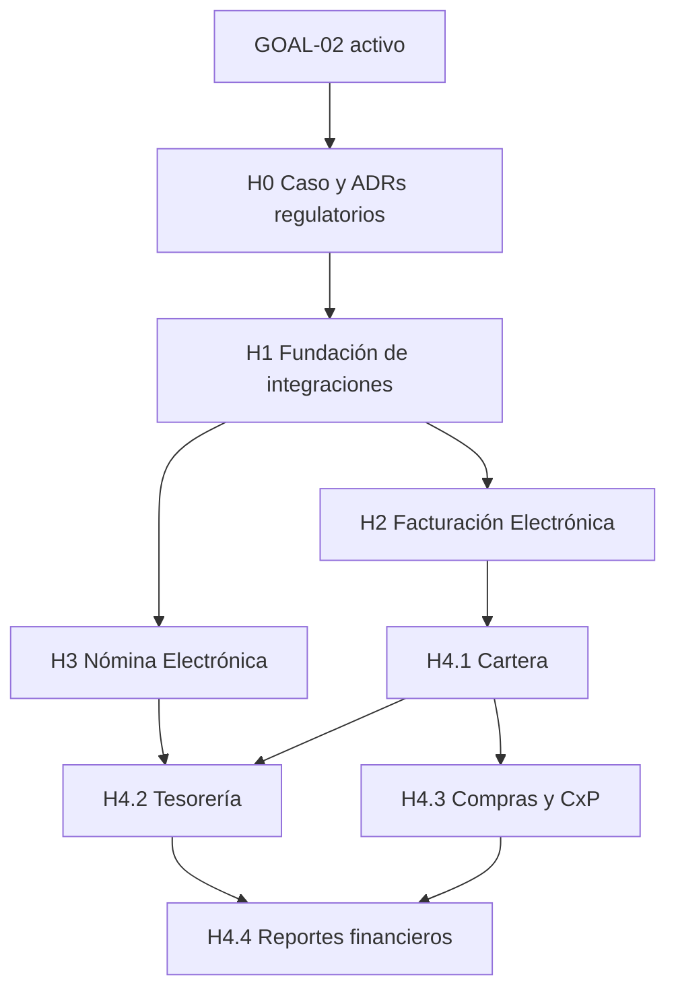

# GOAL-02 — Evolución Financiera y Cumplimiento Electrónico

> **Estado:** GOAL ACTIVO desde 2026-10-30 por decisión explícita del usuario.
> GOAL-01 queda PAUSADO — NO CERRADO; su alcance y trabajo pendiente se
> conservan. La nueva prioridad comercial es poder demostrar nómina,
> facturación y contabilidad integradas a futuros clientes.

## Propósito

Definir la arquitectura de evolución para que la plataforma pueda operar
facturación electrónica, nómina electrónica y capacidades financieras
relacionadas sin convertir el SaaS en un ERP genérico ni acoplar el dominio a
un transmisor específico.

El nombre describe una evolución de negocio, no una secuencia obligatoria de
calendario. Las iniciativas podrán ejecutarse en paralelo cuando sus
dependencias estén resueltas y exista un caso comercial verificable.

## Resultado de negocio propuesto

Cuando este Goal sea activado, un tenant podrá:

- emitir documentos de facturación electrónica mediante un proveedor
  especializado, observando estados normalizados y conservando la evidencia de
  transmisión;
- generar y transmitir nómina electrónica a partir de una liquidación aprobada
  e inmutable, incluyendo rechazos, reintentos y correcciones trazables;
- administrar las consecuencias financieras de facturación, nómina, compras y
  pagos con el Ledger existente como fuente contable;
- sustituir el proveedor de transmisión sin modificar Payroll, Billing,
  Contabilidad, Expediente ni la interfaz de usuario;
- reconstruir cada resultado regulatorio y contable desde su hecho interno,
  snapshot, intento de integración y evidencia almacenada.

Este resultado no implica construir un motor propio de transmisión a la DIAN o
la UGPP. La hipótesis de planificación es integrar inicialmente un proveedor
especializado, por ejemplo Matías API o un equivalente, detrás de adaptadores
propios.

## Alcance y límites

### Dentro del alcance propuesto

1. **Facturación Electrónica:** evolución de la factura interna hacia un acto
   fiscal con numeración, impuestos, notas, estados de transmisión, evidencia
   y conciliación con Contabilidad y Cartera.
2. **Nómina Electrónica:** documento regulatorio derivado de PayrollSnapshot,
   con identidad de evento, correcciones, transmisión, respuesta del proveedor
   y conservación de evidencia.
3. **Evolución financiera:** conexión controlada entre hechos de negocio y
   Ledger; Cartera; Tesorería y pagos cuando exista una necesidad operativa;
   Compras y cuentas por pagar; y reportes financieros que consuman fuentes
   contables completas.
4. **Plataforma de integraciones:** puertos internos, adaptadores, credenciales
   por tenant, idempotencia, reintentos, auditoría, observabilidad y pruebas de
   contrato para proveedores externos.

### Fuera del alcance inicial

- implementar transmisión directa propia contra DIAN o UGPP;
- convertir la plataforma en ERP contable integral;
- construir conectores bancarios genéricos antes de validar un banco o flujo
  concreto;
- duplicar Payroll, Invoice, Ledger, documentos o almacenamiento para satisfacer
  a un proveedor;
- aceptar como fuente de verdad los estados, consecutivos o totales devueltos
  por el proveedor;
- diseñar un motor genérico de workflows, eventos distribuidos o microservicios
  sin un caso de uso que justifique la complejidad;
- implementar una integración concreta antes de aprobar las decisiones de
  dominio, seguridad y operación correspondientes.

## Evidencia actual contrastada en `main`

La fuente de contraste de este documento se actualizó contra `main` en el commit `c9eb6fbe816b8347fb5e612097853020c9bcb6d1` (2026-11-06), después de integrar PR #278–#286, #290–#291, #293, #302–#307; los antecedentes siguientes conservan sus fechas históricas. Los PR #267–#269 actualizan guías de snapshots, campos de identificación del candidato y su vínculo verificable con el empleado. El PR #232 hizo visible el bloqueo del campo UPC 56 en PILA; el cambio actual lo resuelve para dependientes 01/00 de acuerdo con AT2 v30 §2.1.2.3.23 y mantiene 40/69 fuera del MVP. El PR #233 rechaza la prima de julio–diciembre, fuera del MVP aprobado; la revisión oficial del 2026-11-04 no encontró una regla general para el corte operativo previo al pago de diciembre y conserva esa limitación. El PR #234 rechaza novedades PILA para empleados inactivos y bloquea la generación/reliquidación si uno queda asociado a novedades después de inactivarse. El PR #235 completa la matriz del cálculo de prima para todos los conceptos estables de Payroll y bloquea conceptos o tipos desconocidos. El seed de demo emite facturas a través de BillingService y contabiliza las emitidas en Ledger; la factura en borrador permanece sin asiento. El PR #237 verifica desde la UI el comprobante de una factura emitida y sus movimientos de cartera, ingreso e IVA. El PR #265 añade la puerta de serialización de candidatos: fuentes no soportadas, campos pendientes o decisiones ausentes fallan cerradas. Los PR #266–#269 corrigen la guía, validación y trazabilidad de candidatos. PR #283 elimina las alertas altas de dependencias de producción verificadas antes de continuar con GOAL-02; PR #284 añade el puerto interno de proveedor electrónico y pruebas con fake sin transmitir. PR #285 añade el agregado fiscal persistente, líneas snapshot y RLS. PR #286 incorpora perfil emisor y rangos de numeración tenant-scoped, con asignación atómica preparada para una transacción de emisión; no crea ni transmite facturas. PR #291 añade persistencia de intentos, resultados, transiciones y evidencia privada con RLS; no transmite. PR #307 añade prorrateo estándar para ingresos a mitad de un mes completo, con salario mensual de referencia y días congelados en snapshots/correcciones; no habilita PILA parcial. CI, Browser E2E y publicación de imagen API posteriores a PR #291 y #307 pasaron.

PR #290 también integró la exportación CSV de reportes contables: las tablas
paginadas descargan la página visible y balances/estados financieros descargan
el resultado completo de sus filtros. El CSV está cubierto por Browser E2E; no
modifica el Ledger.

PR #303 incorporó la orquestación interna de un intento contra el puerto del
proveedor, sin adaptador operativo ni transmisión. PR #304 agregó en
`/facturacion/electronica` un resumen autenticado y tenant-scoped de las últimas
50 transmisiones y de su intento más reciente. La vista omite payload, claves
idempotentes y evidencia privada; no envía ni concilia facturas ni confirma
aceptación DIAN. El estado de `main` se verificó en `e1f7d54e07aabc9d3303ee23114f21824398b998`.

| Capacidad                  | Evidencia real                                                                                                                                                                                                                                                                         | Límite actual                                                                                                                                                                                                                                                                                                                                                                                                                                                                                                                                                                                                                                                                                                                     |
| -------------------------- | -------------------------------------------------------------------------------------------------------------------------------------------------------------------------------------------------------------------------------------------------------------------------------------- | --------------------------------------------------------------------------------------------------------------------------------------------------------------------------------------------------------------------------------------------------------------------------------------------------------------------------------------------------------------------------------------------------------------------------------------------------------------------------------------------------------------------------------------------------------------------------------------------------------------------------------------------------------------------------------------------------------------------------------- |
| Multiempresa y seguridad   | `Tenant`, JWT, `ActiveTenantGuard`, RBAC y `TenantPrismaService`                                                                                                                                                                                                                       | La integración regulatoria necesitará credenciales y permisos por tenant.                                                                                                                                                                                                                                                                                                                                                                                                                                                                                                                                                                                                                                                         |
| Empleados y contratos      | `Empleado`, contratos, sedes, perfiles y snapshots                                                                                                                                                                                                                                     | Son los insumos laborales; no deben ser modificados por el proveedor.                                                                                                                                                                                                                                                                                                                                                                                                                                                                                                                                                                                                                                                             |
| Payroll                    | `PayrollPeriod`, `PayrollRun`, `PayrollConcept`, `PayrollSnapshot`, parámetros legales, causación y correcciones                                                                                                                                                                       | `PayrollService` aprueba y conserva snapshots; la UI permite preflight y causación ADMIN en Ledger y muestra el comprobante. Las correcciones se contabilizan como ajustes separados después de la causación original. El E2E financiero verifica el cálculo del período, revisión, aprobación, snapshot, causación única, comprobante en UI y reintento idempotente con fixture sintético. La prima está disponible como prototipo para enero–junio; PR #233 deshabilita y rechaza julio–diciembre, que permanece fuera del MVP pendiente de revisión laboral del corte. No existe documento ni transmisión de nómina electrónica.                                                                                               |
| Facturación                | `Customer`, `ProductService`, `Invoice`, `InvoiceItem` y `BillingService`; además existen modelos Prisma reservados `ClienteFE`, `Producto`, `Factura` e `ItemFactura`                                                                                                                 | La emisión de una factura interna nueva contabiliza en Ledger dentro del flujo tenant-scoped; el tercero, el período abierto y los snapshots tributarios son explícitos, y cancelar crea reversión auditable si había comprobante (#179). Las líneas nuevas congelan tasas explícitas de 0%, 5% o 19% y su impuesto; el seed de demo emite dos facturas mediante `BillingService`, conserva una en borrador y valida idempotencia y resultado en UI (#216). El E2E #237 abre Contabilidad y verifica desde la UI el comprobante de la factura emitida, las cuentas de cartera/ingreso/IVA y el balance débito-crédito. No hay transmisión DIAN; los modelos FE heredados no son un adaptador operativo.                           |
| Contabilidad               | `CuentaContable`, `Tercero`, `ComprobanteContable`, `MovimientoContable`, `LedgerService`, reportes y cierres                                                                                                                                                                          | Payroll y Billing tienen puentes explícitos hacia el Ledger; #208 expone consulta y detalle de comprobantes. El E2E #237 verifica el comprobante y sus movimientos para facturas emitidas, y el flujo E2E de Payroll valida la causación desde la nómina calculada/aprobada. El Ledger también soporta reversión y cierres. Aún falta validar los escenarios con un tenant demo real y revisión contable-fiscal antes de operar facturas reales; no es un ciclo contable completo.                                                                                                                                                                                                                                                |
| Preparación PILA           | Afiliaciones históricas, fuentes PILA en PayrollSnapshot, centros y actividades ARL, ubicación laboral confirmada, mappers, preflight y exportación local AT2 v30                                                                                                                      | #219 conserva ubicación laboral histórica; #223–#227 incorporan captura e importación tenant-scoped de afiliaciones, ubicaciones y centros ARL. #278 compone archivos tipo 1/2 desde snapshots aprobados; #279 añade historial inmutable tenant-scoped, reglas/versiones, hashes, almacenamiento privado, auditoría e historial de descargas. Esta continuación verifica generación, persistencia idempotente y descarga de ambos archivos desde la UI. Solo dependientes estándar 01/00 sin brechas pueden generar; los casos que requieren segmentación y correcciones aprobadas se bloquean. No se declara aceptación de operadores ni se transmite, liquida o paga la planilla. Cotizantes 40/69/75 permanecen fuera del MVP. |
| Documentos                 | `GeneratedDocument`, PDF, Expediente Digital, familias y revisiones inmutables                                                                                                                                                                                                         | Puede conservar XML, PDF, acuses y respuestas como evidencia, respetando ADR-006.                                                                                                                                                                                                                                                                                                                                                                                                                                                                                                                                                                                                                                                 |
| Almacenamiento             | `StorageProvider`, disco local, Cloudflare R2 y migración                                                                                                                                                                                                                              | R2 y producción requieren validación operativa; el dominio no debe conocer el backend.                                                                                                                                                                                                                                                                                                                                                                                                                                                                                                                                                                                                                                            |
| Operación                  | scheduler, reintentos, retención, auditoría y alertas conforme a ADR-007                                                                                                                                                                                                               | No existe todavía un motor específico de ejecuciones regulatorias.                                                                                                                                                                                                                                                                                                                                                                                                                                                                                                                                                                                                                                                                |
| Integraciones regulatorias | Existe el puerto interno de proveedor con fake contractual (PR #284), el dominio fiscal persistente con líneas snapshot y RLS (PR #285), y el perfil emisor/rangos de numeración (PR #286). No hay adaptador MATIAS, transmisión DIAN/UGPP, worker ni endpoints operativos de emisión. | El fake comprueba el límite de código, no conformidad DIAN ni aceptación de operador. PR #291 añadió persistencia de intentos y evidencia con RLS, hashes y almacenamiento privado. Siguen pendientes credenciales por tenant, endpoint/worker, observabilidad operativa y validación en sandbox; ADR-020 concreta H1 sin aprobar toda ADR-SEC-001.                                                                                                                                                                                                                                                                                                                                                                               |

## Persistencia de intentos en `main` — PR #291 — 2026-11-05

El `main` en `6496dccc86cd2cd10c17d5c3dfcc20866b64606a` ya incluye un servicio
interno que registra la identidad idempotente del evento fiscal, intentos
numerados, resultados normalizados, transiciones append-only y referencias a
evidencia privada con hash. La migración añade claves compuestas tenant-scoped,
RLS y restricciones de integridad. El servicio no está conectado a un endpoint,
worker o interfaz, ni llama a MATIAS o DIAN; aún no es un flujo utilizable por
clientes. Faltan resolver credenciales por tenant, observabilidad operativa y
validar el sandbox antes de transmitir.

Los ajustes contables de nómina solo se pueden contabilizar después de que el
período original esté `CAUSADA` y conserve un comprobante de causación vigente.
El asiento de diferencia no reemplaza el asiento original; si falta este último,
el ajuste debe permanecer pendiente.

La existencia de `ClienteFE`, `Factura`, `ItemFactura`, `feTecnicoId`,
`feTecnicoKey` y referencias a Matías en el schema no demuestra que exista
facturación electrónica operativa. Tampoco autoriza a extender esos campos como
si fueran el contrato definitivo del proveedor. Antes de H2 debe decidirse si
esa cohorte se migra, se relaciona con `Invoice` o se depreca; la integración
debe quedar detrás del adaptador y los secretos no deben permanecer como
credenciales planas del modelo de tenant.

## Arquitectura objetivo

### Modular monolith como primera forma de despliegue

Se conserva el monolito modular NestJS/Next.js/Prisma/PostgreSQL. La separación
se logra mediante límites de módulo, puertos y contratos, no mediante
microservicios anticipados.

Los módulos internos conservarán la propiedad de sus hechos:

- `Payroll` es dueño del período, cálculo, snapshot, aprobación y corrección;
- `Billing` es dueño de la factura interna, sus líneas, cliente y acto fiscal
  interno;
- `Accounting` es dueño del Ledger, períodos, comprobantes, movimientos y
  reportes derivados;
- `Expediente`/`GeneratedDocuments` son dueños de la evidencia documental y su
  inmutabilidad;
- `Regulatory Integrations` es dueño únicamente de la coordinación de
  transmisión, estados normalizados, intentos y referencias externas.

Ningún módulo regulatorio debe escribir directamente en tablas internas de otro
módulo para simular una aceptación externa. Debe invocar un caso de uso del
dominio propietario y registrar su propia evidencia de integración.

### Frontera dominio–proveedor

```text
Payroll / Billing / Accounting
            │ hechos internos y snapshots inmutables
            ▼
Casos de uso regulatorios
            │ contrato interno estable + idempotency key
            ▼
Puerto de proveedor
            │
            ├── MatiasProviderAdapter
            ├── OtroProviderAdapter
            └── Fake/ContractTestProvider
            │ DTO, autenticación y errores propios del proveedor
            ▼
Proveedor externo / DIAN / UGPP
```

El dominio interno es dueño de:

- identidad del hecho y del documento;
- datos fiscales y laborales normalizados que la plataforma conoce;
- numeración interna y relación con Invoice, PayrollSnapshot, Ledger y
  Expediente;
- estados internos, idempotencia, intentos, reintentos y reglas de transición;
- auditoría, retención y evidencia de lo enviado y recibido.

El adaptador es dueño de:

- credenciales, certificados, endpoints, headers y DTOs externos;
- identificadores, códigos técnicos y estados particulares del proveedor;
- serialización XML/JSON, firma o preparación exigida por el proveedor;
- traducción de respuestas y errores hacia el contrato interno.

El dominio no importa tipos de Matías, DIAN, UGPP ni de otro proveedor. Cambiar
de proveedor debe sustituir el adaptador y su configuración, no modificar
Payroll, Billing, Accounting, Expediente ni la UI.

### Contratos internos mínimos

Los nombres siguientes son contratos conceptuales para el diseño; no son un
mandato de crear estas tablas sin ADR y diseño de dominio específico.

```ts
interface ElectronicInvoicingProvider {
  submitInvoice(input: ProviderInvoiceSubmission): Promise<ProviderResult>;
  submitCreditNote(input: ProviderCreditNoteSubmission): Promise<ProviderResult>;
  submitDebitNote(input: ProviderDebitNoteSubmission): Promise<ProviderResult>;
  queryStatus(input: ProviderStatusQuery): Promise<ProviderResult>;
}

interface ElectronicPayrollProvider {
  submitPayroll(input: ProviderPayrollSubmission): Promise<ProviderResult>;
  queryStatus(input: ProviderStatusQuery): Promise<ProviderResult>;
}
```

El contrato de dominio debe ser independiente del proveedor y debe transportar
solo información necesaria. `ProviderResult` se normaliza a estados internos y
conserva referencias externas, códigos técnicos y evidencia sin convertirlos
en reglas de negocio.

### Idempotencia, reintentos y evidencia

- La clave idempotente se deriva del acto interno y del evento regulatorio, no
  de un UUID nuevo por intento.
- Reenviar el mismo acto es un reintento; una corrección debe ser un evento o
  documento relacionado distinto, conforme a ADR-006 y a la decisión de dominio
  específica.
- Los intentos de transmisión son append-only o inmutables después de
  materializar su respuesta; nunca se sobreescribe la evidencia histórica.
- Los estados de transmisión son independientes de `Invoice.status`,
  `PayrollPeriodStatus` y del estado contable. Una respuesta del proveedor no
  puede alterar silenciosamente un período cerrado o un comprobante ya
  contabilizado.
- Scheduler, auditoría y retención de ADR-007 se reutilizan antes de introducir
  una cola distribuida u outbox general.
- XML, PDF, acuses y respuestas relevantes se almacenan mediante
  `StorageProvider` y, cuando corresponda, se incorporan al Expediente con su
  familia documental correcta.

## Hitos y dependencias

Estos hitos ordenan el trabajo del Goal activo. La transmisión regulatoria
permanece sujeta a sus dependencias de negocio, dominio, seguridad y operación.

### H0 — Caso de negocio y decisiones regulatorias

**Resultado:** alcance comercial y regulatorio aprobado para un primer caso
real.

**Dependencias para la ruta regulatoria:** caso de uso y cliente objetivo,
proveedor seleccionado o shortlist, obligaciones aplicables, ambiente de
pruebas, certificados y secretos operativos. El cierre de GOAL-01 no es una
dependencia; permanece pausado mientras GOAL-02 está activo.

**Trabajo preparatorio:** aprobar ADRs de dominio para factura fiscal, notas,
identidad de eventos de nómina, correcciones, numeración, retención y relación
con Ledger/Expediente. Aprobar también la frontera de seguridad de certificados
y proveedores prevista en ADR-SEC-001.

### H1 — Fundación de integraciones regulatorias

**Resultado:** un caso de integración puede ejecutar, reintentar, auditar y
conservar evidencia sin conocer el proveedor.

**Reutiliza:** Tenant context, RBAC, `AuditService`, scheduler de ADR-007,
`StorageProvider`, GeneratedDocument, Expediente, idempotencia existente y
controles de seguridad.

**Dependencias:** H0, modelo de secretos por tenant, rate limiting, observación
de jobs y contrato interno de proveedores.

**No incluye:** una API pública genérica ni un motor de transmisión propio.

### H2 — Facturación Electrónica

**Resultado:** una factura interna válida puede convertirse en un documento
fiscal, enviarse mediante un adaptador, recibir estado normalizado y dejar
evidencia reproducible de aceptación, rechazo o contingencia.

**Reutiliza:** Customer, ProductService, Invoice, InvoiceItem, la cohorte FE
heredada solo después de resolver su relación de dominio, Tercero, Ledger, PDF,
StorageProvider, Expediente, auditoría y scheduler.

**Dependencias:** H1, ADR de dominio fiscal, numeración, impuestos, notas,
certificados, configuración del proveedor y pruebas de contrato.

**Relación:** alimenta Cartera y Contabilidad; no reemplaza la factura interna
ni permite que el proveedor sea la fuente de verdad.

### H3 — Nómina Electrónica

**Resultado:** una nómina aprobada y snapshotada puede producir el evento
regulatorio correspondiente, transmitirse mediante adaptador, gestionar
rechazo/reintento/corrección y conservar evidencia vinculada al período y al
empleado sin mutar el snapshot.

**Reutiliza:** PayrollPeriod, PayrollRun, PayrollSnapshot, PayrollConcept,
parámetros legales, correcciones, GeneratedDocument, StorageProvider, scheduler,
auditoría y Ledger.

**Dependencias:** H1, ADR de semántica de eventos regulatorios, reglas vigentes,
certificados, proveedor y ambiente de pruebas. No depende de Tesorería para su
primera transmisión.

**Relación:** alimenta Expediente, cumplimiento laboral, Contabilidad y futuras
capacidades de pagos.

### H4 — Evolución financiera

H4 se divide en capacidades que pueden avanzar por evidencia de negocio:

| Capacidad                   | Resultado                                                                               | Dependencias principales                                          |
| --------------------------- | --------------------------------------------------------------------------------------- | ----------------------------------------------------------------- |
| H4.1 — Cartera              | saldos, vencimientos, recaudos, pagos parciales y aplicación contra facturas            | H2, Invoice estable, Tercero, Ledger y un caso de cobro real      |
| H4.2 — Tesorería            | obligaciones, pagos, dispersión y conciliación operativa                                | Payroll/Compras/Cartera, datos bancarios y flujo de pago concreto |
| H4.3 — Compras y CxP        | proveedores, órdenes/obligaciones, causación y documentos soporte                       | Tercero, Ledger, workflows aprobados y necesidades de proveedor   |
| H4.4 — Reportes financieros | flujo de efectivo, patrimonio, notas y exportaciones construidos desde hechos completos | H4.1–H4.3 o fuentes equivalentes verificadas                      |

**Regla:** ningún reporte nuevo debe presentar una cifra como integral si la
fuente de hechos todavía es parcial. `ReportingService` y `LedgerService` son
los puntos de reutilización; no se crea un libro paralelo.

## Grafo de dependencias



El grafo no obliga a implementar H2 antes de H3: ambos comparten H1, pero sus
decisiones de dominio y proveedores son distintas. H4 se prioriza según el
hecho económico que el primer cliente de esa evolución necesite operar.

## Dependencias no funcionales y operativas

- proveedor especializado con ambiente de pruebas y contrato operativo;
- certificados y secretos separados por tenant, con rotación y revocación;
- staging y producción verificables, sin probar transmisiones reales desde el
  entorno local;
- política de privacidad, retención y eliminación/anonimización para XML,
  acuses, errores y datos laborales;
- monitoreo de jobs, métricas de aceptación/rechazo, alertas y soporte;
- controles de acceso por tenant y separación de deberes para emitir, aprobar,
  corregir y cerrar;
- pruebas de contrato con un fake provider y, posteriormente, pruebas sandbox
  del proveedor elegido;
- evidencia de continuidad, recuperación y no duplicación ante timeout,
  respuesta tardía o caída del proveedor.

## Riesgos y mitigaciones

| Riesgo                                                         | Mitigación arquitectónica                                                                                          |
| -------------------------------------------------------------- | ------------------------------------------------------------------------------------------------------------------ |
| Lock-in de Matías u otro proveedor                             | Puertos internos, adaptadores reemplazables y pruebas de contrato.                                                 |
| Duplicación por reintentos o timeouts                          | Identidad de evento, idempotencia interna y estados de intento separados.                                          |
| Cambio normativo                                               | ADRs por dominio, parámetros versionados y revisión antes de cada cambio regulatorio.                              |
| Proveedor acepta algo que el dominio no debe aceptar           | El proveedor solo devuelve resultado técnico; el dominio valida invariantes y conserva su estado.                  |
| Alteración de nómina o contabilidad histórica                  | Snapshots, períodos cerrados, append-only y correcciones como nuevos actos.                                        |
| Fuga de certificados o PII                                     | Secretos fuera del dominio, mínimo dato compartido, RBAC, auditoría y rotación.                                    |
| ERPización prematura                                           | Cada iniciativa requiere un caso de uso y una fuente de hechos verificable.                                        |
| Confundir la cohorte FE heredada con una integración operativa | ADR de reconciliación de modelos y adaptador independiente; no ampliar campos específicos de Matías en el dominio. |

## ADRs requeridos antes de implementar

Este documento no sustituye decisiones que cambian el comportamiento del
producto. Antes de iniciar una Epic regulatoria deberán revisarse o crearse,
como mínimo:

- ADR de modelo fiscal: factura, nota, consecutivo, impuestos, contingencia y
  relación con Ledger;
- ADR de modelo de nómina electrónica: unidad de transmisión, evento, período,
  corrección, rechazo y relación con PayrollSnapshot;
- ADR del puerto/adaptadores de proveedores, incluyendo contrato interno,
  secretos, sandbox, webhooks o consulta de estados;
- ADR de custodia de certificados, evidencia, retención y respuesta ante
  incidentes, relacionado con ADR-SEC-001;
- ADR de Tesorería y Cartera si el caso de negocio requiere pagos, recaudos o
  conciliación;
- ADR de Compras/CxP si se prioriza ese flujo sobre otras expansiones.

Si alguna de estas decisiones cambia el alcance o las invariantes del dominio,
la implementación debe detenerse hasta su aprobación.

## Estado de activación y puertas regulatorias

GOAL-02 quedó activado el 2026-10-30 por instrucción explícita del usuario.
GOAL-01 se pausa sin cerrarse. El alcance de GOAL-02 conserva su resultado de
negocio completo: capacidades financieras integradas y transmisión regulatoria
verificable. El primer milestone prioriza hacer demostrables y coherentes los
flujos internos existentes de nómina, facturación y contabilidad.

La activación del Goal no equivale a autorización para transmitir a DIAN o UGPP.
Antes de cada Epic regulatoria deben documentarse y verificarse:

- cliente, obligación y caso de uso que justifican la transmisión;
- proveedor elegido o decisión explícita de mantener una abstracción con más de
  un candidato;
- ambiente sandbox, certificados, secretos y responsables operativos;
- ADRs de dominio, seguridad e integración aprobados;
- dependencias actuales de Payroll, Billing y Accounting contrastadas contra
  `main`;
- criterios end-to-end y evidencia esperada para el primer tenant.

El backlog exclusivo y ordenado de GOAL-02 está en
[`GOAL-02-backlog.md`](GOAL-02-backlog.md). Las condiciones que faltan para la
transmisión regulatoria quedan pendientes ahí; no bloquean el trabajo interno
de demostración que no dependa de ellas.

## Estado de esta referencia

- `GOAL-01`: pausado, no cerrado.
- `GOAL-02`: único Goal activo desde 2026-10-30.
- Facturación Electrónica: planificada, no implementada.
- Nómina Electrónica: planificada, no implementada.
- Evolución financiera: parcialmente fundada por Accounting, pero no completa.
- Integración Matías API: no implementada; cualquier proveedor debe entrar por
  adaptador.
